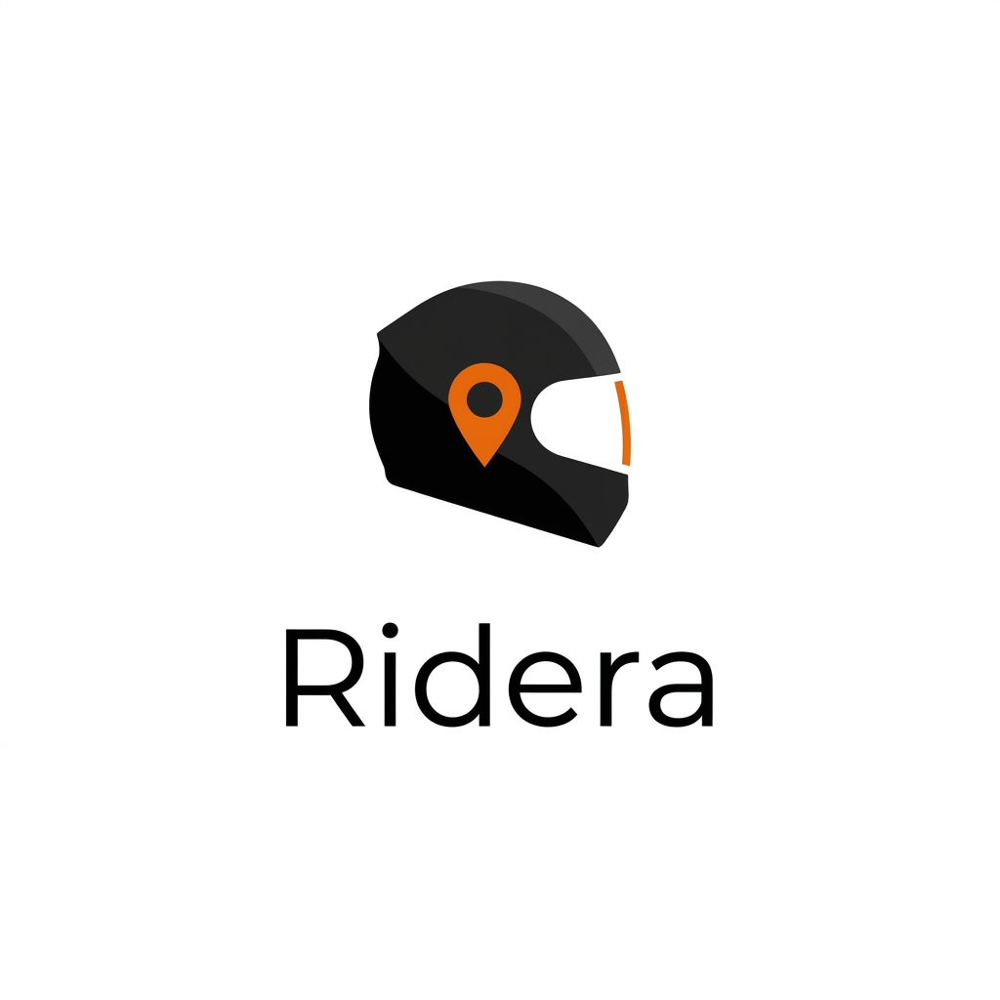
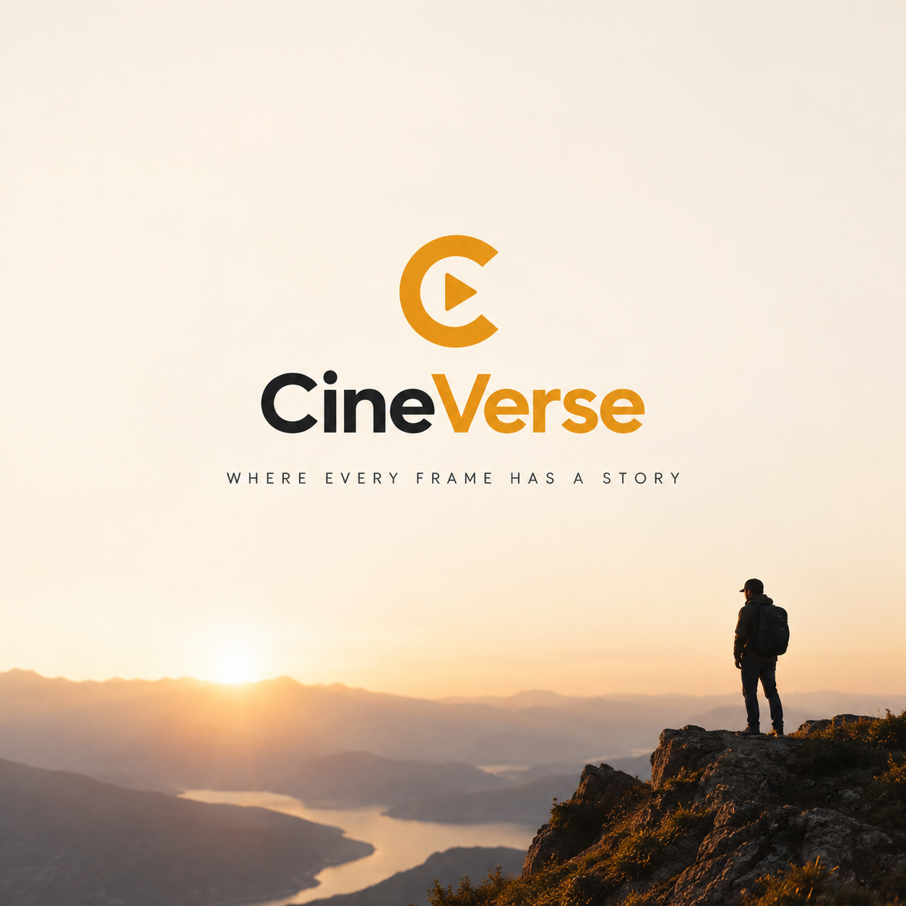

<!-- ========================================== -->
<!-- SECTION 1: ANIMATED HERO & ROUNDED HUD     -->
<!-- ========================================== -->

  

<!-- ROUNDED PILL TELEMETRY BADGES -->

  
  &nbsp;&nbsp;
  
  &nbsp;&nbsp;
  

 

<!-- ========================================== -->
<!-- SECTION 2: CORE SYSTEMS & PROJECTS        -->
<!-- ========================================== -->

### 01 / CORE SYSTEMS & PROJECTS

> Software engineer and cinematographer based in Kenya. Building practical backend infrastructure, mobile applications, and applied AI integrations.

 

<!-- PROJECT 01: RIDERA PLATFORM (SIDE-BY-SIDE CARD) -->
<table width="100%">
  <tr>
    <td width="35%" valign="middle" align="center" style="padding: 0;">
      
    </td>
    <td width="65%" valign="top" style="padding-left: 16px;">
      
<code>[ PRJ // 001 ]</code>

      <h3 style="margin-top: 0;">RIDERA PLATFORM</h3>
      
<b>MOTORCYCLE TELEMETRY &amp; SOCIAL INFRASTRUCTURE</b>

      

        Ridera is a full-stack motorcycle telemetry and social infrastructure platform built to bridge real-time rider metrics with community ride-discovery. Engineered with high-concurrency backend services, the platform powers live GPS trip tracking, group route synchronization, dynamic waypoint discovery, and community engagement through a responsive mobile architecture.
      

       
      

        
      

      

        <code>STATUS: ACTIVE DEVELOPMENT</code> &bull; <a href="https://github.com/yaas-3r/ridera"><b>VIEW REPOSITORY &rarr;</b></a>
      

    </td>
  </tr>
</table>

 

<!-- PROJECT 02: CINEVERSE PLATFORM (SIDE-BY-SIDE CARD) -->
<table width="100%">
  <tr>
    <td width="35%" valign="middle" align="center" style="padding: 0;">
      
    </td>
    <td width="65%" valign="top" style="padding-left: 16px;">
      
<code>[ PRJ // 002 ]</code>

      <h3 style="margin-top: 0;">CINEVERSE</h3>
      
<b>CINEMATOGRAPHY PLATFORM &amp; COLLABORATION ENGINE</b>

      

        CineVerse is a cinematic ecosystem engineered for filmmakers, documentarians, and visual storytellers. Designed to merge high-bitrate video discovery with collaborative production workflows, the platform is driven by a scale-ready API architecture capable of real-time video streaming, spatial location indexing, camera telemetry parsing, and intelligent crew matching across global productions.
      

       
      

        
      

      

        <code>STATUS: ACTIVE DEVELOPMENT</code> &bull; <a href="https://github.com/yaas-3r/cineverse"><b>EXPLORE SYSTEM &rarr;</b></a>
      

    </td>
  </tr>
</table>

 

<!-- PROJECT 03: APPLIED AI PIPELINES -->
<table width="100%">
  <tr>
    <td width="100%" valign="top">
      
<code>[ PRJ // 003 ]</code>

      <h3 style="margin-top: 0;">APPLIED AI PIPELINES</h3>
      
<b>BACKEND INTELLIGENCE &amp; MODEL ORCHESTRATION</b>

      

        Experimental micro-architecture designed for orchestrating local/edge models, managing vector caches, and integrating context-aware LLM pipelines into production backend services.
      

       
      

        
      

      

        <code>STATUS: SYSTEM EXPLORATION</code> &bull; <code>R&amp;D MODULE</code>
      

    </td>
  </tr>
</table>

 

<!-- ========================================== -->
<!-- SECTION 3: METRICS (AT THE BOTTOM)         -->
<!-- ========================================== -->

### 02 / ANALYTICS

  

