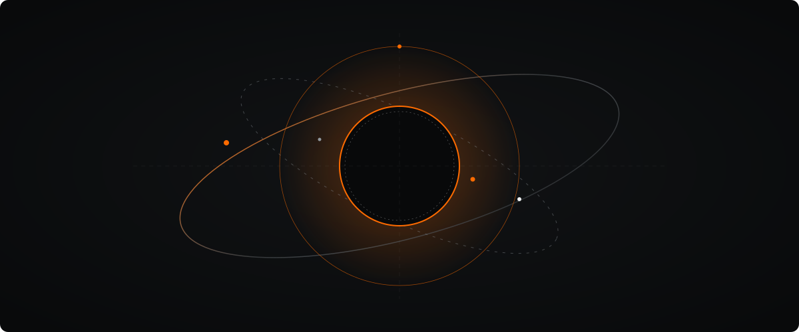

  <!-- HERO ANAMORPHIC ARTWORK -->
  

    

  <!-- DESIGNED NAVIGATION BAR -->
  

  

    <a href="#01--engineering--function"><b>[ 01. ENGINEERING ]</b></a> &nbsp;&nbsp;&bull;&nbsp;&nbsp;
    <a href="#02--frame--film--cinematography"><b>[ 02. CINEMATOGRAPHY ]</b></a> &nbsp;&nbsp;&bull;&nbsp;&nbsp;
    <a href="#03--about"><b>[ 03. ABOUT ]</b></a> &nbsp;&nbsp;&bull;&nbsp;&nbsp;
    <a href="#04--connect"><b>[ 04. CONNECT ]</b></a>
  

 
 

## 01 / ENGINEERING & FUNCTION

> Developing software systems, backend infrastructure, mobile applications, and exploring practical AI integrations.

 

<table>
  <tr>
    <td width="42%" valign="top">
      
    </td>
    <td width="58%" valign="top">
      <h3>01. RIDERA</h3>
      
<strong>Motorcycle Social &amp; Ride-Discovery Platform</strong>

      
A specialized digital platform connecting rider communities, enabling route discovery, journey sharing, and real-time group navigation.

      
<em>Note: Visual preview above is conceptual architecture artwork.</em>

       
      
<code>TypeScript</code> &bull; <code>React Native</code> &bull; <code>Node.js</code> &bull; <code>PostgreSQL</code>

      
<a href="https://github.com/yaas-3r/ridera"><b>Explore Repository &rarr;</b></a>

    </td>
  </tr>
</table>

 
 

## 02 / FRAME & FILM &mdash; CINEMATOGRAPHY

> Visual motion, filmic composition, lighting, and editorial video storytelling.

 

<!-- FEATURED MAIN FILM -->

  

<!-- SUPPORTING FILM STRIP (3 COLUMNS) -->
<table>
  <tr>
    <td width="33%" valign="top" align="center">
      
        
      
<a href="https://github.com/yaas-3r"><b>Watch Full Film &rarr;</b></a>

    </td>
    <td width="33%" valign="top" align="center">
      
        
      
<a href="https://github.com/yaas-3r"><b>Watch Full Film &rarr;</b></a>

    </td>
    <td width="33%" valign="top" align="center">
      
        
      
<a href="https://github.com/yaas-3r"><b>Watch Full Film &rarr;</b></a>

    </td>
  </tr>
</table>

 
 

## 03 / ABOUT

I am <strong>Yaasir Mohammad</strong>, a software engineer and cinematographer based in Kenya.

My work bridges technical software engineering—backend systems, mobile architecture, and AI integration—with visual storytelling through filmmaking, color grading, and video editing.

 
 

## 04 / CONNECT

 

  
<em>"Better systems. Bigger adventures."</em>

   
  

    <a href="https://github.com/yaas-3r"><b>GitHub Profile</b></a>
  

