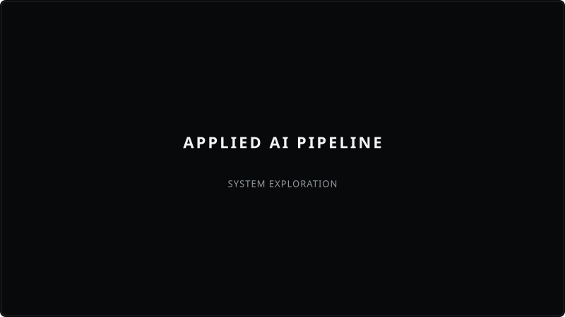
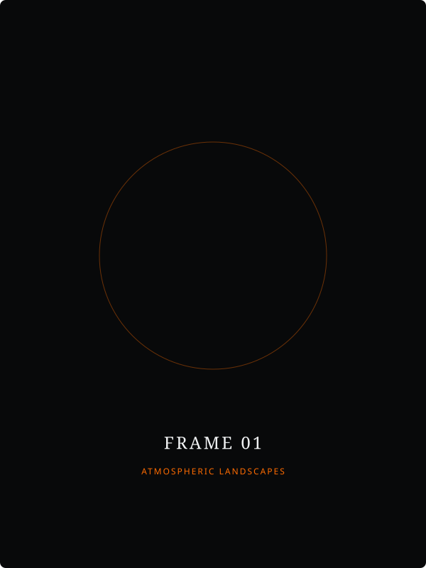

  <!-- HERO ARTWORK -->
  

    

  <h1>YAASIR MOHAMMAD</h1>
  
<strong>SOFTWARE ENGINEER &nbsp;|&nbsp; BUILDER &nbsp;|&nbsp; CINEMATOGRAPHER</strong>

  
<em>Kenya &nbsp;&bull;&nbsp; Building Ridera &nbsp;&bull;&nbsp; Exploring Backend Systems, AI & Motion</em>

   

  

    <a href="#01--engineering--function"><b>[ 01. ENGINEERING ]</b></a> &nbsp;&nbsp;&bull;&nbsp;&nbsp;
    <a href="#02--moving-images--cinematography"><b>[ 02. CINEMATOGRAPHY ]</b></a> &nbsp;&nbsp;&bull;&nbsp;&nbsp;
    <a href="#03--connect"><b>[ 03. CONNECT ]</b></a>
  

## 01 / ENGINEERING & FUNCTION

> Building practical digital products, exploring scalable backend infrastructure, and integrating applied AI into real-world software.

 

<table>
  <tr>
    <td width="42%" valign="top">
      
    </td>
    <td width="58%" valign="top">
      <h3>01. RIDERA</h3>
      
<strong>Motorcycle Social & Ride-Discovery Platform</strong>

      
A specialized platform for connecting rider communities, discovering curated routes, sharing journeys, and facilitating group ride navigation.

      
<code>TypeScript</code> &bull; <code>React Native</code> &bull; <code>Node.js</code> &bull; <code>PostgreSQL</code>

      
<a href="https://github.com/yaas-3r/ridera"><b>Explore Repository &rarr;</b></a>

    </td>
  </tr>
</table>

 

<table>
  <tr>
    <td width="42%" valign="top">
      
    </td>
    <td width="58%" valign="top">
      <h3>02. APPLIED AI PIPELINES</h3>
      
<strong>Practical Intelligence Integration</strong>

      
Exploratory architecture for integrating micro-models and LLM APIs into backend service pipelines with continuous evaluation.

      
<code>Python</code> &bull; <code>FastAPI</code> &bull; <code>Docker</code> &bull; <code>Redis</code>

      
<a href="https://github.com/yaas-3r"><b>Explore Repository &rarr;</b></a>

    </td>
  </tr>
</table>

## 02 / MOVING IMAGES & CINEMATOGRAPHY

> Visual motion, filmic composition, color grading, and editorial storytelling.

 

<table>
  <tr>
    <td width="50%" valign="top" align="center">
      
        
      <h4>FRAME 01 — ATMOSPHERIC LANDSCAPES</h4>
      
<em>Director of Photography & Editor</em>

      
<a href="https://github.com/yaas-3r"><b>Watch Full Film &rarr;</b></a>

    </td>
    <td width="50%" valign="top" align="center">
      
        
      <h4>FRAME 02 — URBAN MOTION</h4>
      
<em>Cinematographer & Colorist</em>

      
<a href="https://github.com/yaas-3r"><b>Watch Full Film &rarr;</b></a>

    </td>
  </tr>
  <tr>
    <td width="50%" valign="top" align="center">
      
        
      <h4>FRAME 03 — RIDER CHRONICLES</h4>
      
<em>Director & Editor</em>

      
<a href="https://github.com/yaas-3r"><b>Watch Full Film &rarr;</b></a>

    </td>
    <td width="50%" valign="top" align="center">
      
        
      <h4>FRAME 04 — SHORT EXPERIMENTAL</h4>
      
<em>Editing & Sound Design</em>

      
<a href="https://github.com/yaas-3r"><b>Watch Full Film &rarr;</b></a>

    </td>
  </tr>
</table>

## 03 / CONNECT

 

  
<em>"Better systems. Bigger adventures."</em>

   
  

    <a href="https://github.com/yaas-3r"><b>GitHub</b></a> &nbsp;&bull;&nbsp;
    <a href="https://linkedin.com"><b>LinkedIn</b></a> &nbsp;&bull;&nbsp;
    <a href="mailto:contact@yaasir.dev"><b>Email</b></a>
  

